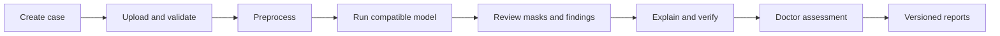
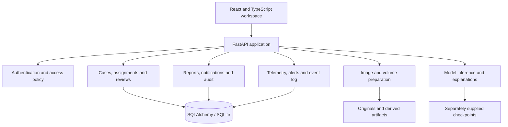

<div align="center">


# CoroVision AI

### From angiography to evidence. From evidence to expert review.

A role-based research workspace for coronary artery segmentation, suspected stenosis localization, explainability and reporting.

**Infosys Springboard · Team 2**

`React + TypeScript` · `FastAPI` · `PyTorch` · `Docker`

[Quick start](#quick-start) · [Features](#features) · [Supported analyses](#supported-analyses) · [Architecture](#architecture) · [Results](#measured-results) · [Documentation](#documentation)

📘 **New here?** Read the [Instruction Guide (PDF)](docs/CoroVision_AI_Instruction_Guide.pdf) for setup and every screen, and the [Project Report (PDF)](docs/CoroVision_AI_Project_Report.pdf) for the full project documentation.

</div>

---

> **Research prototype, not a medical device.** AI masks and measurements support research and expert review. They are not a diagnosis, a validated stenosis grade, or medical advice. Use only public or appropriately de-identified data.

## Overview

CoroVision turns a de-identified imaging study into a traceable research record: create a case, prepare the image, run a compatible model, inspect the result with its explanation, record a doctor's separate assessment, and export a versioned report.



The original image is always kept. Preparation creates a derived copy and never starts training.

## Features

| Area | What it does |
| :--- | :--- |
| **Cases and uploads** | De-identified cases, metadata, DICOM frame or PDF page selection, ROI cropping, previews, case-level sharing. |
| **Preprocessing** | Standard, noise reduction, contrast enhancement, or both. Originals and processing records are retained. |
| **AI analysis** | 2D artery segmentation with suspected-stenosis candidates; 3D coronary and aorta segmentation with linked MPR, surface and CPR views. |
| **Explainable AI** | Grad-CAM, Grad-CAM++ and occlusion maps with deletion, insertion and randomization sanity checks. A gallery shows the saved heatmaps. |
| **Reports and exports** | A case chooser covers 2D and 3D cases. Each report is an immutable version, exported as PDF, CSV, JSON or an Evidence ZIP. Reports repeat a saved run and never re-run the model. |
| **Expert review** | Doctor decisions and severity are stored separately from model output. Saved mask corrections never overwrite the original model mask. |
| **Model registry** | Active model, release provenance, training scope, evaluation results and live monitoring for administrators. |
| **Operations** | Administrator console: readiness, request and error rates, memory and storage gauges, live API traffic by route, trends over 1, 6 or 24 hours, searchable event log with CSV export, alert channels and test alerts. |
| **Access control** | Role-specific actions, assigned cases by default, optional shared team workspace, audit log, time-based authenticator enrollment. |
| **Demonstrations** | Clearly labelled synthetic known-truth fixtures with an expected-versus-actual evidence manifest ([policy](docs/DEMONSTRATION_EVIDENCE.md)). |

## Supported analyses

New cases accept only combinations that have a connected model. Anything else is rejected when the case is created.

| Modality | Anatomy | Dimension | Model |
| :--- | :--- | :--- | :--- |
| **XCA** (X-ray coronary angiography) | Coronary | 2D | ResNet34 U-Net (artery) and Mask R-CNN (stenosis candidates) |
| **CTA** | Coronary | 3D | ImageCAS 3D U-Net |
| **CTA** | Aorta | 3D | Aorta baseline trained on pseudo-labels |
| **CT** | Aorta | 3D | Aorta baseline trained on pseudo-labels |

Cerebral and hepatic anatomy, MRA, and whole-body artery segmentation are **not** supported. Stenosis output is a research candidate list, not a validated grade.

## Roles

| Role | Main responsibility |
| :--- | :--- |
| **Doctor** | Review authorized cases, findings, severity assessments and reports. |
| **Medical Researcher** | Prepare research cases, explore outputs, inspect evaluations. |
| **Technician / Data Operator** | Intake, uploads, metadata and preparation quality. |
| **ML Engineer** | Model records and evaluation artifacts. Training controls are not connected. |
| **Viewer** | Read shared case details and recorded results. |
| **Administrator** | Users, access, audit, operations and monitoring. |

For shared team visibility set `CV_CASE_VISIBILITY=shared` ([guide](docs/SHARED_CASE_WORKSPACE.md)). Visibility never grants review, edit or export rights beyond role and case permissions.

## Architecture



SQLite is the local default. PostgreSQL can be configured through `DATABASE_URL`, but production use needs its own security, operations and privacy review.

## Quick start

> Need help at any step? See the [Instruction Guide (PDF)](docs/CoroVision_AI_Instruction_Guide.pdf) and the [Project Report (PDF)](docs/CoroVision_AI_Project_Report.pdf).

### Docker (recommended)

Requires Docker with Compose, 4 GiB free disk and 8 GiB RAM recommended.

```bash
git clone --branch lingareddy-dhanush https://github.com/springboardmentor01092s-tech/Team_2_Artery-Segmentation-DL.git
cd Team_2_Artery-Segmentation-DL
python scripts/configure.py
python scripts/preflight.py
docker compose up --build -d
docker compose exec app python -m app.cli create-admin
```

Open <http://127.0.0.1:8000> and check readiness:

```bash
curl -fsS http://127.0.0.1:8000/api/health/ready
```

The first build installs the 2D research checkpoints after verifying their release hashes. The 3D checkpoint is supplied separately; without it the 3D interface shows an unavailable state. Each clone has its own database, administrator and storage. Full steps: [clean-clone quick start](docs/QUICKSTART.md) and [fresh-clone guide](docs/FRESH_CLONE_SETUP.md).

**Trained models:** the [276 MB model ZIP](https://github.com/springboardmentor01092s-tech/Team_2_Artery-Segmentation-DL/releases/download/corovision-mask-models-v1/CoroVision_application_mask_models_v1.zip) is published on the [model release](https://github.com/springboardmentor01092s-tech/Team_2_Artery-Segmentation-DL/releases/tag/corovision-mask-models-v1). Cloning alone does not install weights; see [model installation](docs/FRESH_CLONE_SETUP.md#install-trained-models).

### Local development

Requires Python 3.11 to 3.13, Node.js 20+ and npm.

```bash
# Backend
cd backend
python3 -m venv .venv && source .venv/bin/activate
pip install -r requirements.txt
export JWT_SECRET="$(python3 -c 'import secrets; print(secrets.token_urlsafe(48))')"
uvicorn app.main:app --reload --host 127.0.0.1 --port 8000
```

```bash
# Frontend, in a second terminal
cd frontend
npm ci
npm run dev -- --host 127.0.0.1
```

| Open | Address |
| :--- | :--- |
| Application | <http://127.0.0.1:5173> |
| API documentation | <http://127.0.0.1:8000/docs> |

Keep the JWT secret stable in private configuration, because a new value invalidates existing sessions. Never commit credentials. See [authentication setup](docs/AUTH_SETUP.md), [administrator access](docs/ADMIN_ACCESS.md) and [backend/.env.example](backend/.env.example). Provider sign-in and email recovery need their own service configuration.

<details>
<summary><strong>Optional: connect inference artifacts</strong></summary>

Weights are not in this repository. Install `backend/requirements-ai.txt`, supply the expected checkpoints and follow [AI analysis setup](docs/AI_ANALYSIS.md) and the [trained release guide](docs/TRAINED_RELEASE_INTEGRATION.md). Related guides: [3D inference](docs/3D_INFERENCE.md), [CTA workspace](docs/3D_CASE_WORKSPACE.md), [single-worker job deployment](docs/INFERENCE_JOB_DEPLOYMENT.md), [explainability](docs/EXPLAINABLE_AI.md), [monitoring](docs/MONITORING_AND_LOGGING.md) and [operations and readiness](docs/OPERATIONS_AND_READINESS.md). Model-dependent actions stay unavailable without the artifacts, and a source checkout is not evidence that a model is installed or validated.

</details>

## Measured results

Figures are research measurements on the stated cohort and are not clinical performance.

| Task | Result | Notes |
| :--- | :--- | :--- |
| 3D coronary (ImageCAS, development validation) | Dice 0.7937, recall 0.7879 | 150 volumes on the prepared 128-voxel grid. |
| 3D coronary (ASOCA, external reference) | Dice 0.3573, IoU 0.2201, HD95 21.48 mm | 40 expert-reference pairs on the native grid. Limited external generalization. One empty prediction counted as Dice 0. |
| 2D artery and stenosis | Trained on ARCADE only | Not validated on other angiography sources. |

The two 3D scores come from different cohorts and grids and must not be compared directly. These values are shown on the application's **Model Evaluation** page. Dataset-level results and incomplete work: [measured-results report](reports/latest_measured_training_results.md). Not every dataset has completed training, and training remains paused.

## Project status

| Area | Status |
| :--- | :--- |
| 2D XCA artery segmentation and stenosis candidates | Working end to end. Trained on ARCADE only. |
| 3D coronary CTA (ImageCAS model) | Working. Development validation strong, external ASOCA result limited. |
| 3D aorta (CTA and CT) | Working baseline trained on pseudo-labels. Not expert-validated. |
| Explainable AI, reports, operations and monitoring | Working and covered by browser tests. |
| Cerebral, hepatic, MRA | Not connected. Removed from case creation. |
| Independent clinical validation | Not done. This is research software. |

The `lingareddy-dhanush` and `review` branches are kept identical.

## Development and testing

```bash
# backend/, with its environment active
pytest -q

# frontend/, after npm ci
npx tsc --noEmit
npm run build
node --test tests/*.test.mjs

# browser tests need a running server and seeded demo accounts
DEMO_CREDENTIALS_PATH=/path/to/demo-credentials.json npx playwright test
```

Latest full run (28 November 2026): backend 482 passed (11 skipped), frontend 64 unit tests passed, browser suite 19 passed (2 skipped). These verify engineering behavior, not clinical safety or model validity. The reference-mask browser acceptance harness is in [REFERENCE_MASK_ACCEPTANCE.md](docs/REFERENCE_MASK_ACCEPTANCE.md).

**Not yet established:** independent validation on a cleared unseen cohort, expert mask semantics and native-grid pairing; a real CTA case passing the strict candidate rules; hosted authenticated workflows, recovery, monitoring and load evidence.

## Repository guide

```text
backend/      FastAPI services, access policy, preprocessing and tests
frontend/     React application, role workspaces, themes, UI and browser tests
ml/           Shared preprocessing code, release metadata and configuration
scripts/      Setup, preflight, dataset audits and documentation tools
docs/         Architecture, workflows, datasets and implementation scope
reports/      Selected aggregate measured-result reports
deploy/       Deployment configuration
```

This branch is application-only: training notebooks, runners, queues and checkpoint-evaluation scripts are not published. Databases, uploads, datasets, weights, secrets and build output are excluded from Git, and datasets and checkpoints keep their original licenses.

## Documentation

| Topic | Links |
| :--- | :--- |
| **Start here** | [Instruction Guide (PDF)](docs/CoroVision_AI_Instruction_Guide.pdf): clone, Docker, start-up, every section and button, 2D and 3D workflows · [Instruction Guide (Markdown)](docs/INSTRUCTION_GUIDE.md) · [Project Report (PDF)](docs/CoroVision_AI_Project_Report.pdf): abstract, datasets, models, methods, results and limits |
| Product and scope | [Project scope](docs/PROJECT_SCOPE.md) · [Comprehensive PRD](docs/CoroVision_AI_Comprehensive_PRD_Infosys_Springboard_Team_2.md) |
| Architecture and design | [Architecture](docs/ARCHITECTURE.md) · [Database schema](docs/PRD_DATABASE_SCHEMA.md) · [Wireframes](docs/WIREFRAMES.md) |
| Workflows | [Frontend workflow](docs/FRONTEND_WORKFLOW.md) · [Role section map](docs/ROLE_SECTIONS_ROUTE_MATRIX_2026-10-16.md) |
| Images and datasets | [Preprocessing requirements](docs/PREPROCESSING_ENGINE_REQUIREMENTS.md) · [Dataset registry](docs/DATASET_REGISTRY.md) |
| Access and publishing | [Authentication](docs/AUTH_SETUP.md) · [Administrator access](docs/ADMIN_ACCESS.md) · [Publishing rules](docs/GIT_PUBLISHING.md) |
| Evidence | [Correctness policy](COROVISION_CORRECTNESS_POLICY.md) · [Demonstration evidence](docs/DEMONSTRATION_EVIDENCE.md) |

Dated documents may describe earlier stages. Rely on current code, explicit "not connected" states and measured-result artifacts for actual availability.

## Responsible use

This academic prototype is not a production clinical system. Real patient use or public deployment needs an approved privacy and security process, institution-managed identity, secure transport, secret management, retention and backup policies, and clinical validation.

**AI findings and a doctor's assessment are different records.** A mask is not a confirmed lesion, a pixel score is not clinical confidence, and uncalibrated image geometry is not a validated physical measurement.

## License and acknowledgements

See [LICENSE](LICENSE). Third-party components keep their own terms: [frontend notices](frontend/THIRD_PARTY_NOTICES.md), [PrismUI](frontend/LICENSE.prismui.md) and [Watermelon](frontend/LICENSE.watermelon.md). Dataset licenses and access conditions apply independently.

---

<div align="center">

**CoroVision AI · Infosys Springboard · Team 2**

Research with traceability. Review with context.

</div>
