# CoroVision AI - Instruction Guide

> Research prototype, not a medical device. Not for diagnosis or treatment decisions.


## Start here

CoroVision AI is a research workspace for coronary artery segmentation, suspected stenosis (narrowing) localization, explainability and reporting. It handles two kinds of studies: **2D X-ray angiography (XCA)** images and **3D coronary CT angiography (CTA)** volumes. It also has a 3D aorta workflow for CTA and CT.

> **Important.** **Research prototype, not a medical device.** The AI outlines vessels and flags regions for a person to review. It does not diagnose, it does not give a validated stenosis grade, and it is not medical advice. Use only public or properly de-identified images.


### Who this guide is for

- **A new developer or evaluator** who wants to download the project, start it and try every feature.
- **A researcher, doctor, technician or student** who has been given a login and wants to know what each screen and button does.
- **An administrator** who sets up the installation, invites users and watches its health.


### How the guide is organised

| Part | What you will find |
|---|---|
| A. Get the code | Prerequisites and cloning the project from GitHub. |
| B. Start with Docker | Configure, build and start the application, create the first administrator and check that it is healthy. |
| C. Add the required files | Model files, settings, optional Google sign-in and email, and what formats you can upload. |
| D. First sign-in and navigation | Signing in, the top bar, the sidebar and what each role can see. |
| E. The whole workflow | A one-page picture of how a study moves through the application. |
| F. Section-by-section reference | Every section, tab and button, with what it does, when to use it and how. |
| G. Complete 2D walkthrough | A numbered run through an X-ray angiography study. |
| H. Complete 3D walkthrough | A numbered run through a coronary CTA volume. |
| I. Administration | Users, roles, case access, audit log and the Operations console. |
| J. Help | Glossary, troubleshooting and responsible use. |

> **Tip.** Every button table in this guide has four columns: **Button** (the exact label on screen), **What it does**, **When to use it** and **How to use it**. Screenshots come from a demonstration installation. Case codes and numbers on your screen will differ.


## Part A. Get the code from GitHub


### A1. What you need first

| Item | Why | Check it works |
|---|---|---|
| Git | Downloads the project. | git --version |
| Docker Desktop (or Docker Engine with Compose) | Runs the whole application in one container. Recommended. | docker --version  and  docker compose version |
| Python 3.11 to 3.13 | Runs the setup helper scripts (they only need standard Python). | python3 --version |
| 4 GiB free disk, 8 GiB RAM recommended | The image with the research models is large. | Docker Desktop settings show memory |
| A web browser | Chrome, Edge, Firefox or Safari. | - |
| Node.js 20+ and npm (only if you run without Docker) | Builds the web interface in local development. | node --version |


### A2. Clone the repository

The working branch is called **lingareddy-dhanush**. The branch **review** holds the same code. Do not use **main**: it only holds the licence file.

```bash
git clone --branch lingareddy-dhanush https://github.com/springboardmentor01092s-tech/Team_2_Artery-Segmentation-DL.git
cd Team_2_Artery-Segmentation-DL
```

1. Open a terminal (Terminal on macOS, PowerShell or Git Bash on Windows).
2. Move to the folder where you want the project, for example your Desktop.
3. Paste the clone command above and press Enter. Wait until it finishes.
4. Run the second line to move into the new folder. All later commands are run from here.


### A3. What is inside the folder

| Folder or file | What it is for |
|---|---|
| backend/ | The server (FastAPI): accounts, cases, uploads, analysis, reports. |
| frontend/ | The web interface (React and TypeScript) and its tests. |
| ml/ | Shared preprocessing code, model release records and settings. |
| scripts/ | Helper scripts: configure.py, preflight.py, setup_local.py, run_local.py, check_local.py. |
| docs/ | Detailed guides (quick start, administrator access, 3D inference, explainability and more). |
| compose.yaml | The Docker Compose recipe. Extra files (compose.3d.yaml and others) add optional parts. |
| Dockerfile | How the application image is built. |
| README.md | Short overview of the project. |

> **Important.** Cloning does **not** download trained model weights, datasets or anyone's accounts and images. Those are separate on purpose. Part C explains how to add the models.


## Part B. Start the application with Docker

Docker packages the server, the web interface and the 2D models into one container, so every computer behaves the same. Follow these steps in order from the project folder.


### B1. Create your private settings

```bash
python3 scripts/configure.py
```

This creates a file named **.env** holding a randomly generated secret (JWT_SECRET) that signs login sessions, plus the port (8000) and the allowed web address. It never prints the secret and refuses to overwrite an existing .env.

> **Important.** Never commit or share the .env file. If you delete it and make a new one, everyone is signed out.


### B2. Run the read-only preflight check

```bash
python3 scripts/preflight.py
```

This checks Docker, free disk space and the configuration, and prints a list of OK or problem lines. It changes nothing and starts no training. Fix anything it reports before continuing.


### B3. Build and start

```bash
docker compose up --build -d
```

1. The first build takes several minutes. It installs the 2D artery and stenosis models after checking their fixed hashes.
2. -d means the application keeps running in the background.
3. Check that it started: docker compose ps. The service should say healthy after a short while.


### B4. Check that it is ready

```bash
curl -fsS http://127.0.0.1:8000/api/health/ready
```

A healthy answer starts with **"status":"ready"** and lists the 2D model as available. The 3D model shows as unavailable until you add its file (Part C).


### B5. Create the first administrator

```bash
docker compose exec app python -m app.cli create-admin
```

1. The command asks for an email and a strong password. Type them in the prompt. They are never stored in your command history.
2. It refuses to create a second initial administrator.
3. Open **http://127.0.0.1:8000** in your browser and sign in with that email and password.
4. On the first sign-in the system asks you to **enrol an authenticator app** (a time-based code, as used by Google Authenticator or similar). Scan the QR code and type the 6-digit code.
5. Then open **User Management** and invite the rest of your team (Part I).

> **Tip.** The Docker setup is **invitation-only**: nobody can create an account without an invitation from an administrator. Demo accounts exist only in the separate local development mode.


### B6. Where your data lives, and how to stop and restart

| Action | Command | What happens to data |
|---|---|---|
| Stop | docker compose stop | Data is kept. |
| Start again | docker compose start | Everything comes back as it was. |
| Restart after changing settings | docker compose up -d | Data is kept. |
| Update to a newer version | git pull  then  docker compose up --build -d | Data is kept in the Docker volume. |
| Look at logs | docker compose logs -f app | Press Ctrl+C to stop watching. |
| Remove containers but keep data | docker compose down | The data volume stays. |

> **Important.** Do not run **docker compose down -v** unless you want to delete the database and all uploaded files. The -v flag removes the data volume.


### B7. Alternative: run without Docker

```bash
python3 scripts/setup_local.py
python3 scripts/run_local.py
```

This installs the backend, builds the web interface and serves everything at http://127.0.0.1:8000. Use **python3 scripts/check_local.py** in a second terminal to verify it. Add **--demo** to setup to create sample accounts for the seven roles (their passwords are saved only in the ignored file backend/demo-credentials.json). Demo mode is for a local computer only.


## Part C. Add the required files and settings


### C1. The 2D models (artery and stenosis)

The Docker build installs these automatically. To install by hand, download **CoroVision_application_mask_models_v1.zip** (276 MB) from the GitHub release page named **corovision-mask-models-v1**, check that its SHA-256 starts with **bd780e66**, and run:

```bash
python3 scripts/setup_local.py --with-ai --model-archive /path/to/CoroVision_application_mask_models_v1.zip
```

The installer checks every file hash and refuses a wrong package. For Docker with an already downloaded ZIP, put it alone in a folder as **models.zip** and build with **--build-context model_archive=/folder** (see docs/FRESH_CLONE_SETUP.md).


### C2. The 3D coronary CTA model

The 3D model file is supplied separately because it is large. Without it the 3D page shows a clear message instead of results. Place the file **imagecas128.pt** in **models/volume_release/**, then start Docker with the extra recipe:

```bash
docker compose -f compose.yaml -f compose.3d.yaml up -d --build
```

You can point to another folder with the variable COROVISION_VOLUME_MODEL_DIR. The file is mounted read-only. Its SHA-256 is pinned in ml/releases/imagecas_3d_128.json and checked before use.


### C3. Settings you may want (in the .env file)

| Setting | What it does |
|---|---|
| JWT_SECRET | Secret that signs sessions. Generated for you by configure.py. |
| COROVISION_PORT | The port the app listens on. Default 8000. |
| CV_CASE_VISIBILITY=shared | Lets the whole team see all cases (view only). Default is that people see only their own and assigned cases. |
| GOOGLE_CLIENT_ID / GOOGLE_CLIENT_SECRET | Turns on Sign in with Google (see C4). |
| OAUTH_REDIRECT_BASE | The web address Google returns to, for example http://127.0.0.1:8000. |
| SMTP_HOST, SMTP_PORT, SMTP_USERNAME, SMTP_PASSWORD, SMTP_FROM | Email settings for password-reset messages. |
| OPS_ALERT_WEBHOOK_URL | Optional Slack, Discord or Teams address that receives operations alerts. |
| OPS_MONITOR=1 | Turns on the background health monitor shown in Operations. |
| DATABASE_URL | Use PostgreSQL instead of the default SQLite file. |


### C4. Google sign-in (optional)

A fresh clone cannot use Google sign-in until you create your own Google credentials. This is a Google requirement, not a project fault.

1. In Google Cloud Console create an OAuth client of type **Web application**.
2. Add the **Authorized JavaScript origin** http://127.0.0.1:8000 (and your real domain later).
3. Add the **Authorized redirect URI** that your installation uses. It is built from OAUTH_REDIRECT_BASE, so check docs/AUTH_SETUP.md for the exact path.
4. Copy the client ID and secret into the .env file as GOOGLE_CLIENT_ID and GOOGLE_CLIENT_SECRET.
5. Restart: docker compose up -d. The **Continue with Google** button on the sign-in page now works.
6. Google asks the person to give consent. That step is theirs to do; nobody can do it for them.


### C5. What you can upload

| Study type | Accepted files | Notes |
|---|---|---|
| 2D X-ray (XCA) | PNG, JPEG, DICOM (including multi-frame), scanned PDF | Pick the right frame or page. Scanned PDFs need Poppler installed. |
| 3D CTA or CT volume | NIfTI (.nii or .nii.gz), a ZIP of a DICOM series, or a set of DICOM files | Upload the original Hounsfield-unit CT, not a prepared or normalised export. |
| Reference mask (optional) | Binary PNG for 2D, NIfTI for 3D | Must match the source geometry exactly. |

> **Important.** Upload only de-identified images. Never type names, dates of birth or other personal details in any field.


## Part D. First sign-in and finding your way around

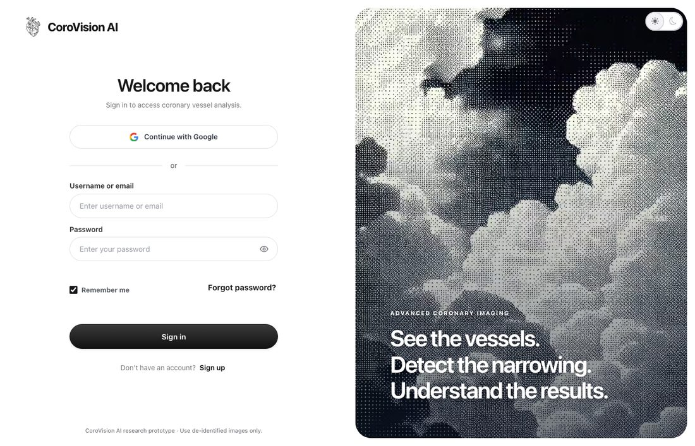
*The sign-in page.*


### D1. Signing in

| Button | What it does | When to use it | How to use it |
|---|---|---|---|
| Continue with Google | Signs you in with a Google account. | When your administrator has set up Google (Part C4). | Click it, choose the account, approve. You return to the app. |
| Username or email / Password | Your account details. | Always. | Type them. The eye button shows or hides the password. |
| Remember me | Keeps you signed in after a page reload until the session expires. | On your own computer only. | Tick it before signing in. |
| Forgot password? | Starts a reset by email. | When you cannot remember the password. | Needs the email settings from C3. |
| Sign in | Submits your details. | After typing them. | Click or press Enter. If your account uses an authenticator app, type the 6-digit code next. |
| Sign up | Asks for a new account. | Only if your installation allows it. | In the Docker setup you need an invitation instead. |


### D2. The top bar

| Button | What it does | When to use it | How to use it |
|---|---|---|---|
| Logo (CoroVision AI) | Returns to your dashboard. | When you are lost. | Click it. |
| Search (Cmd+K or Ctrl+K) | Jumps to any section or case by name. | To open a case quickly. | Press the keys, type a few letters, press Enter. |
| Bell | Shows notifications such as finished analyses or alerts. A red number means unread items. | To see what needs you. | Click it, then click a notification to open it. |
| Sun / moon switch | Switches between light and dark colours. | To suit your room or eyes. | Click the side you want. |
| Collapse sidebar (left panel icon) | Makes the left menu narrow. | To get more room for images. | Click again to widen. |
| + (New case) | Opens the Create case form from anywhere. | To start a study. | Click it. See Section F2. |
| Your name at the bottom left | Opens your account menu. | To sign out or open settings. | Click it. |


### D3. The sidebar by role

The sidebar only lists what your role may use. If a section is missing, your role does not include it. Ask an administrator if you need more.

| Role | Sections in the sidebar |
|---|---|
| Administrator | Administration Overview, Case Inventory, Data & Uploads, Severity Review, AI Analysis, Model Registry, Explainable AI, Reports, User Management, Roles & Permissions, Case Access, Audit Logs, Operations, Profile & Settings |
| Medical Researcher | Research Overview, Research Cases, Data & Uploads, Analysis & Explainability, Model Evaluation, Explainable AI, Reports & Exports, Profile & Settings |
| Doctor | Clinical Overview, Research Cases, Severity Review, Image Review, Explainable AI, Review Reports, Profile & Settings |
| Technician / Data Operator | Dashboard, Case Intake, Data & Uploads, Image Inspection, Explainable AI, Reports, Profile & Settings |
| ML Engineer | ML Overview, Model Evaluation, Profile & Settings |
| Viewer / Student | Dashboard, Assigned Cases, Profile & Settings |

> **Tip.** Seeing a section does not always mean you can do everything in it. Buttons you are not allowed to use are hidden or greyed out, and the server checks every action again.


## Part E. The whole workflow in one page

| Step | Where | What happens |
|---|---|---|
| 1 | Cases > Create case | Register a de-identified study: code, modality (XCA or CTA), anatomy, task. |
| 2 | Data & Uploads | Upload the image (2D) or volume (3D). The app checks the file and prepares a copy. The original is always kept. |
| 3 | Analysis page | Run the analysis. The model outlines the arteries and proposes suspected narrowings. |
| 4 | Analysis page, viewer | Look at the original, mask, overlays, centerline, candidates and measurements. |
| 5 | Explainable AI | See which image areas the model relied on, and the checks that test whether the map is trustworthy. |
| 6 | Severity Review | A doctor records their own decision and notes. This is separate from the AI output. |
| 7 | Reports & Exports | Save an immutable report version and download PDF, CSV, JSON or an Evidence ZIP. |
| 8 | Case, Analysis history | Reopen any saved run later. Nothing is overwritten. |

> **Tip.** Supported study types: XCA + coronary (2D), CTA + coronary (3D), CTA + aorta and CT + aorta (3D). Other combinations are refused when you create the case, because no model is connected for them.


## Part F. Section-by-section reference

Section names change a little by role (for example Cases is called Case Intake for technicians). The content is the same.


### F1. Overview (dashboard)

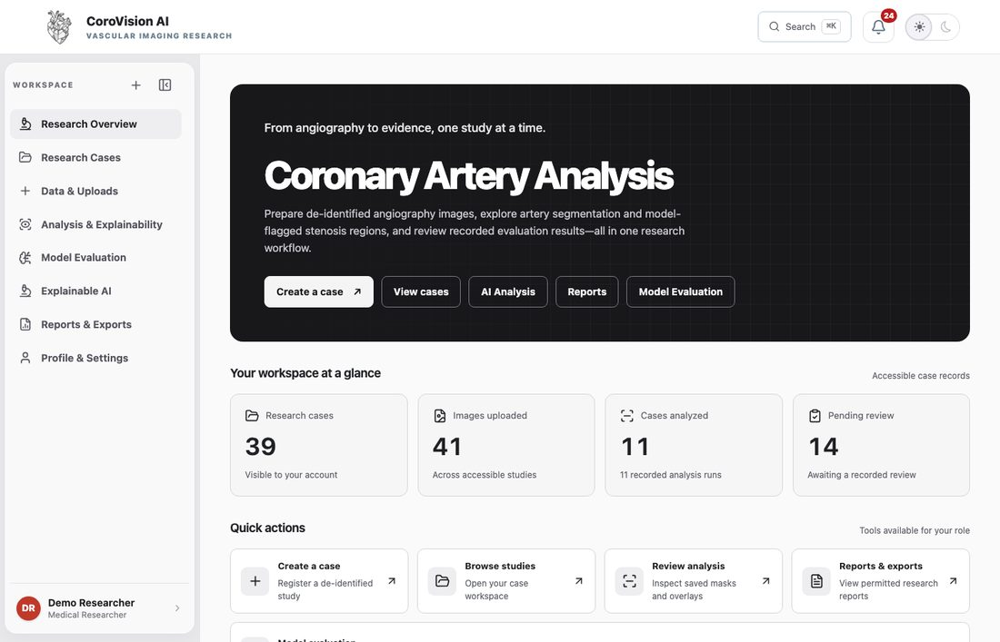
*The research overview.*

Your landing page. It shows counts and shortcuts for what you may open: cases, images, analyses, items awaiting review, recent analyses and processing status.

| Button | What it does | When to use it | How to use it |
|---|---|---|---|
| Create a case | Opens the Create case form. | To begin a new study. | Click it and fill the form (F2). |
| View cases | Opens the case list. | To find an existing study. | Click it. |
| AI Analysis | Opens the analysis page. | To run or review a model result. | Click it. |
| Reports | Opens the Reports hub. | To download reports. | Click it. |
| Model Evaluation | Opens recorded model results. | To see measured performance. | Click it. |
| Quick action cards (Create a case, Browse studies, Review analysis, Reports & exports, Model evaluation) | Same shortcuts as above, with a short description. | Whichever matches your task. | Click a card. |
| View all | Opens the full list behind a panel. | When the panel shows only a few rows. | Click it. |
| All cases / Awaiting review / Reviewed / Other | Filters the study library by state. | To narrow the list. | Click a filter, click again for All. |
| Search by case code | Filters cases as you type. | To find a case fast. | Type part of the code. |
| Open model workspace / Open cases / Open shared viewer / Open reports | Go to that section. | From the Research findings panel. | Click one. |

Administrators also see governance cards (User Management, Roles & Permissions, Access Requests, Model Governance, Audit Logs, Security & Configuration). Each has an **Open administration** button. Viewers see only a short message and **View assigned cases** or **Open case details**. ML Engineers see model lifecycle cards and **Open model workspace**.


### F2. Cases (Research Cases, Case Intake or Case Inventory)

A case is one study and everything about it: images, runs, notes, reviews and reports. Nothing is analysed without a case.

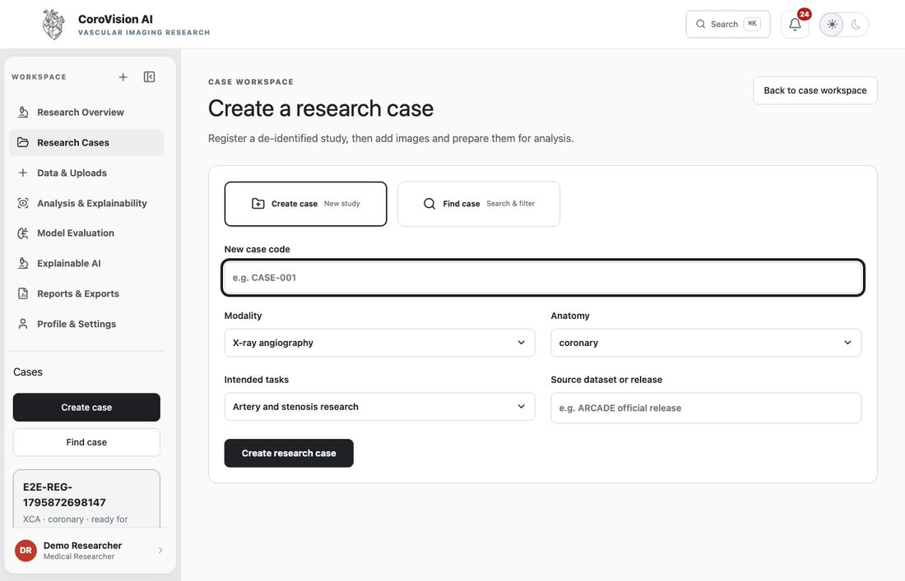
*Creating a case.*


#### Creating a case

| Button | What it does | When to use it | How to use it |
|---|---|---|---|
| Create case | Opens the Create case panel. | To register a new study. | Click it on the Cases page or use the + at the top left. |
| New case code | A short label that identifies the study. | Always. Use a code, never a person's name. | For example ARCADE-001. The app can suggest one. |
| Modality | XCA (X-ray angiography) or CTA / CT. | Always. | Choose the type of images you will upload. |
| Anatomy | Coronary or aorta, limited to what a model supports. | Always. | The list only offers valid pairs. |
| Intended tasks | What the study is for, for example artery and stenosis research. | Always. | Pick the closest option. |
| Source dataset or release | Where the images came from. | Recommended, for traceability. | Write the dataset name or release. |
| Create research case | Saves the case. | When the form is complete. | Click once. You land on the new case. |
| Find case | Searches and filters the list. | To locate a case. | Type a code or choose a filter. |
| Previous / Next | Moves through pages of the list. | When there are many cases. | Click. |

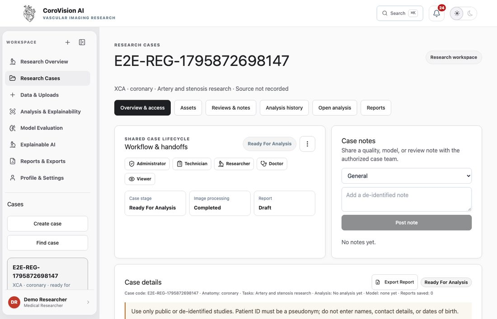
*A case, Overview & access tab.*


#### The four tabs inside a case

Each case has four tabs. The arrows at the bottom (Next: Assets, Next: Reviews & notes and so on) walk you through them in order.

| Button | What it does | When to use it | How to use it |
|---|---|---|---|
| Overview & access | Details, notes, sharing and deletion. | To describe the case or share it. | Click the tab. |
| Assets | The images or volumes that belong to the case. | To see what is uploaded. | Click the tab, click an item to inspect it. |
| Reviews & notes | The doctor's review and decision for this case. | To read or record a review. | Click the tab. |
| Analysis history | Every saved AI run for this case. | To reopen an old result. | Click the tab. |
| Open analysis | Jumps to the analysis page for this case. | To run or view results. | Click it. |
| Reports | Jumps to the report page for this case. | To export. | Click it. |


#### On the Overview & access tab

| Button | What it does | When to use it | How to use it |
|---|---|---|---|
| Workflow & handoffs | Shows the case stage and who is involved. | To see where the case stands. | Read it. Use the stage buttons your role allows. |
| Note category and Case note, Post note | Adds a de-identified note for the team (General, Image quality, Model finding, Clinical review). | To leave a message. | Pick a category, type the note, click Post note. |
| Patient ID (pseudonym), Age band, Gender, Imaging modality, Source dataset, Source reference, Scan date | Case details. | To keep the record accurate. | Fill only de-identified values. |
| Optional clinical context checkboxes (Hypertension, Diabetes and so on) | Adds permitted clinical factors for research. | Only when your project allows it. | First tick the permission box, then the factors. |
| De-identified clinical notes | Free text without personal details. | For short context. | Type, then save. |
| Save case details | Stores the details. | After editing. | Click it. |
| Export Report | Downloads a summary of the case record. | To keep a copy of the case file. | Click it and wait for the download. |
| Assign access (User email or ID, Access level) | Gives another person access: Read, Review, or Edit and upload. | To share the case. | Type their email, choose a level, click Assign access. |
| Delete case... | Moves the case to Trash (an administrator can restore it). | To remove a case you no longer need. | Click it and confirm. |

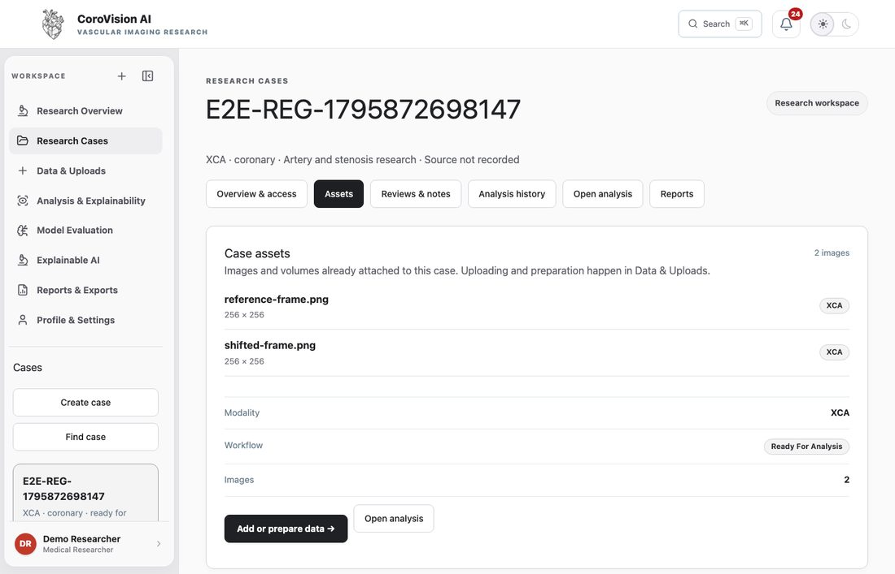
*The Assets tab.*


### F3. Data & Uploads

Where files are added to a case. The page adapts: a 2D case shows image upload, a 3D case shows volume upload.

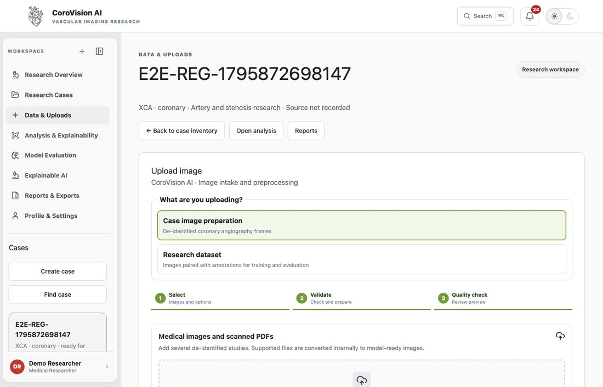
*Uploading and preparing 2D images.*


#### 2D image upload

| Button | What it does | When to use it | How to use it |
|---|---|---|---|
| What are you uploading? (Case image preparation / Research dataset) | Chooses between one case's images and a dataset of images with annotations. | Use Case image preparation for normal work. | Click the card. |
| Medical images and scanned PDFs (drop area) | Accepts PNG, JPEG, DICOM and scanned PDF. | To add images. | Drag files in or click to browse. PDFs are converted to images. |
| Frame or page selection | Chooses which frame of a DICOM or page of a PDF to use. | For multi-frame files. | Pick the one that shows the vessels. |
| Preprocessing profile (Standard, noise reduction, contrast enhancement, both) | Chooses how the copy is prepared. | Start with Standard. Try an enhancement if the image is dark or noisy. | Select it. Enhancements may change thin vessels and are not proven to improve accuracy. |
| Optional ROI (for example 40,50,300,300) | Crops to a region: x, y, width, height in pixels. | To remove borders or text. | Type four numbers, or leave empty. |
| Validate and upload N files | Checks the files, rejects duplicates and bad formats, then stores the original and a prepared copy. | When your files are chosen. | Click and wait for the three steps: Select, Validate, Quality check. |
| Validate & reprocess saved original | Prepares the already saved original again with new settings. | To try another profile without uploading again. | Change the profile, click it. |
| Open analysis / Reports / Back to case inventory | Navigation shortcuts. | After uploading. | Click. |

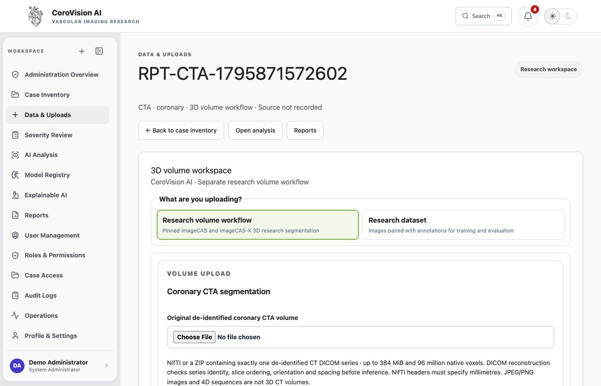
*Uploading a 3D CTA volume.*


#### 3D volume upload

| Button | What it does | When to use it | How to use it |
|---|---|---|---|
| Research volume workflow / Research dataset | Chooses model analysis of one volume or a research dataset. | Use the volume workflow to run the 3D model. | Click the card. |
| Original de-identified coronary CTA volume (Choose File) | Selects a .nii, .nii.gz, ZIP of DICOM, or DICOM files. | To add the CT. | Click Choose File. The app validates ordering, spacing and shape. |
| Confirm the source is Hounsfield-unit CT and research-only (checkboxes) | Records that you uploaded the original scan for research. | Always required. | Tick both boxes. |
| Run 3D segmentation | Uploads, checks the volume and starts the 3D model. | When the file and boxes are ready. | Click and wait. The job goes queued, running, completed. On CPU it can take minutes. |
| Open saved 3D analysis | Opens the finished run. | After completion, or to reopen a saved run. | Click it. |
| Optional 3D preparation (median denoising, local contrast, ROI x,y,z,w,h,d, mask, spacing) | Generic volume preparation and export. It is not model inference. | Only for preparing data. | Open the optional box and fill what you need. |

> **Important.** 3D inference needs the 3D model file from Part C2. If it is missing the page says so and does not pretend to run.


### F4. AI Analysis, 2D (Coronary analysis)

The main workspace for an X-ray angiography study. Doctors see it as Image Review, technicians as Image Inspection, and researchers as Analysis & Explainability. At the top, three selectors choose what you look at.

| Button | What it does | When to use it | How to use it |
|---|---|---|---|
| Case | Chooses the study. | First. | Pick from the list. |
| Study image | Chooses the image in the case. | When a case has several images. | Pick one. |
| Saved analysis run | Chooses an earlier result to reopen. | To review a past run. | Pick a run (date and short id). |
| Run coronary analysis / Run new analysis | Starts the artery and stenosis models on this image. | When no run exists or after changing preprocessing. | Click and wait. Results are saved as a new run; old runs stay. |

The row of rounded section buttons under the title jumps to each part of the page. They appear as data becomes available.

| Section button | What you will find |
|---|---|
| Overview | Combined findings: artery outline, vessel measurements, possible narrowing (saved candidates), screening result and severity status. |
| Source & preprocessing | Where the image came from and every processing step applied. |
| 2D viewer | The image viewer with layers, zoom and the findings inspector. |
| Stenosis candidates | The suspected narrowings with raw scores and positions. |
| Segmentation | Mask sizes, scores, run time. |
| Vessel analysis | Centerline length, widths and branch counts. |
| Explainable AI | Saved heatmaps for this run. |
| Model evaluation | Model identity, checkpoint hash and limits. |
| Measurements & severity | Diameter workflow and the research severity status. |
| Review & history | All runs of this image. |
| Reports & exports | Save report versions and download them. |

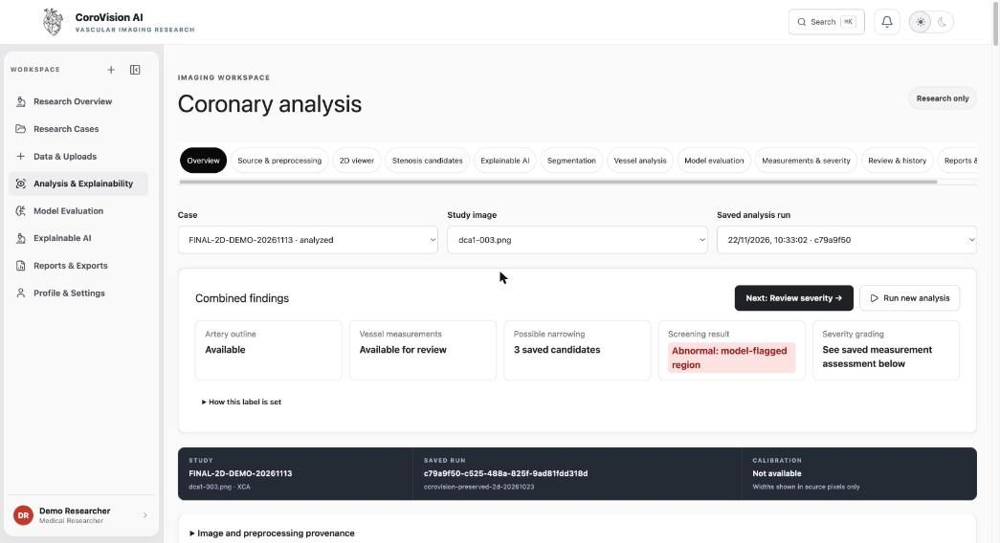
*2D overview: combined findings for a saved run.*

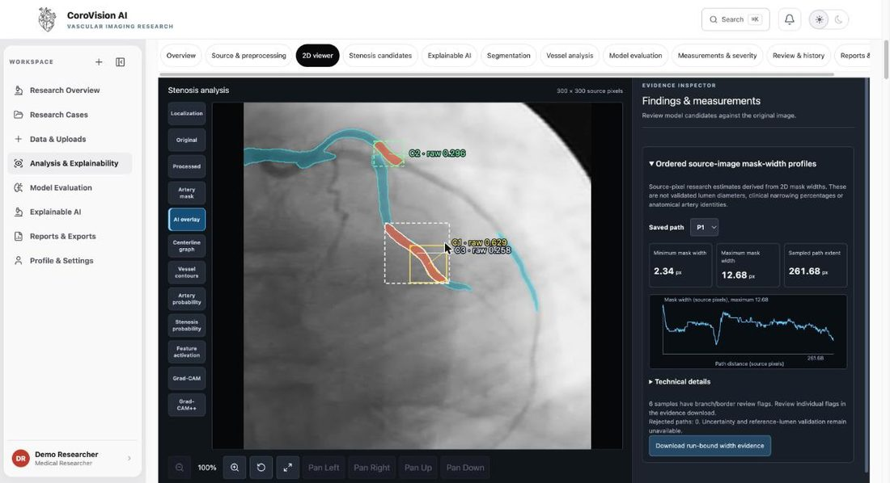
*The 2D viewer with the AI overlay.*


#### The 2D viewer layer buttons (left column)

| Button | What it does | When to use it | How to use it |
|---|---|---|---|
| Localization | Shows boxes around suspected narrowings. | To see where candidates are. | Click it. |
| Original | The image as uploaded. | To judge the raw image. | Click it. |
| Processed | The prepared copy the model saw. | To check preprocessing. | Click it. |
| Artery mask | The predicted artery area in colour. | To check the outline. | Click it. |
| AI overlay | Mask plus candidate boxes on the image. | The best first look. | Click it. Use Overlay opacity to fade it. |
| Centerline graph | The thin line through each vessel with branch points. | To follow vessel paths. | Click it. |
| Vessel contours | Outlines of the vessel edges. | To check widths. | Click it. |
| Artery probability / Stenosis probability | Heat map of model confidence per pixel. | To see how sure the model is. | Click it. Bright means more confident. |
| Feature activation | Where internal model features respond. | For understanding the model. | Click it. |
| Grad-CAM / Grad-CAM++ | Attribution heat maps (explainability). | To see what drove a finding. | Click it. More in F6. |
| Measure | Lets you measure a distance on the image (shown when available). | For rough pixel measurements. | Click it, then click two points. |


#### View controls under the image

| Button | What it does | When to use it | How to use it |
|---|---|---|---|
| Zoom out / Zoom in | Shrinks or enlarges the image. | To inspect detail. | Click, or use the mouse wheel. |
| Reset view | Returns to the default zoom and position. | When lost. | Click. |
| Fit image to screen (expand icon) | Fits the image to the panel or goes full screen. | For a bigger look. | Click. |
| Pan Left, Right, Up, Down | Moves the zoomed image. | After zooming in. | Click, or drag the image. |
| Compare with (Off or a layer) | Shows a second layer to the right of a draggable divider. | To compare original and overlay. | Choose a layer, drag the divider. |
| Overlay opacity slider | Controls how strong the overlay is. | To see the image beneath. | Drag it. |

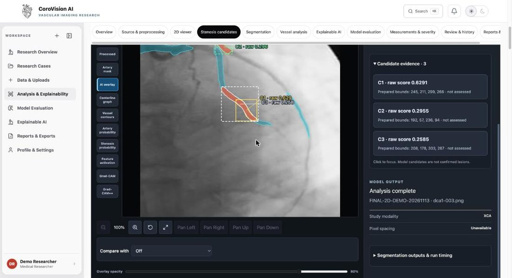
*Candidates list with raw scores and a focus box.*


#### Stenosis candidates and the findings inspector

| Button | What it does | When to use it | How to use it |
|---|---|---|---|
| Candidate cards (C1, C2, C3) | Each shows a raw model score and box coordinates. | To focus on one suspected region. | Click a card to highlight it on the image. |
| Download candidate locations | Saves the candidate list. | To use them elsewhere. | Click it. |
| Saved path (P1, P2...) | Chooses a vessel path for the width profile. | To read widths along one vessel. | Pick a path. |
| Download run-bound width evidence | Saves the width numbers for this exact run. | For records. | Click it. |
| Reassess saved-run measurement readiness | Re-checks whether measurements meet the quality gates. | After new information. | Click it. |

> **Important.** A candidate is a **model-flagged region**, not a confirmed lesion. Raw score is not a probability of disease. Widths are in image pixels unless calibration is recorded. No candidate does not mean the vessel is normal.


#### Align two images

| Button | What it does | When to use it | How to use it |
|---|---|---|---|
| Align two images of this case | Matches a second frame to the selected image after a shift, rotation or small scale change. | When you want to compare two frames. | Open the panel, pick the second image, run the alignment. |
| Blend (red reference, green aligned) / Checkerboard | Two ways to check the alignment. | To see if the frames match. | Click either. |


### F5. AI Analysis, 3D (CTA volume analysis)

When the case is a 3D study, the same page becomes the CTA workspace. It has twelve sections in one long page. Use the rounded buttons at the top to jump between them.

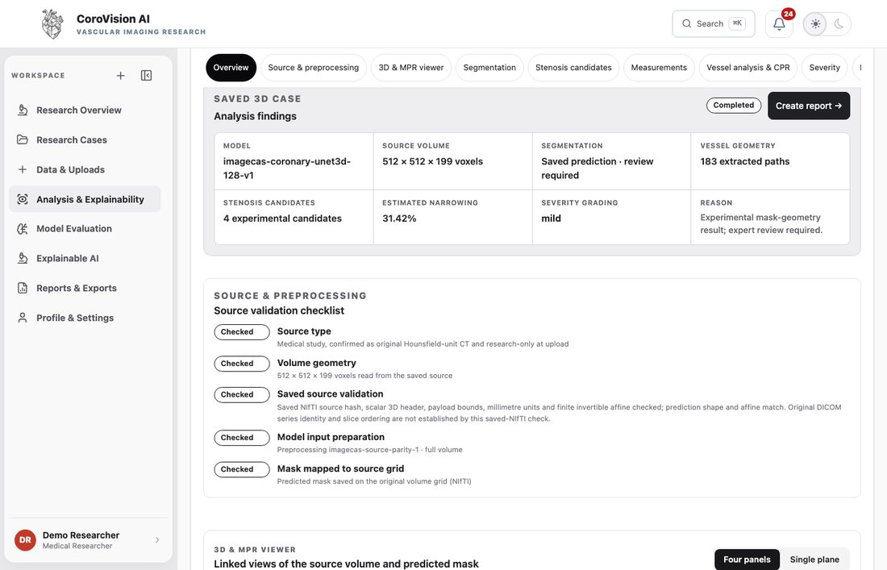
*3D overview of a saved run.*

| Section | What it shows |
|---|---|
| Overview | Model, source size, segmentation status, number of paths, candidates, estimated narrowing, severity. |
| Source & preprocessing | A checklist proving the volume was validated: source type, geometry, preparation and mask alignment. |
| 3D & MPR viewer | Linked slice views and a 3D surface (F5.1). |
| Segmentation | Predicted components and reviewer corrections (F5.2). |
| Vessel analysis & CPR | Vessel paths and the straightened curved view (F5.3). |
| Stenosis candidates | A list of suspected narrowings along the paths. |
| Measurements | Diameters, areas and cross-sections at the candidate (F5.4). |
| Severity | Research severity text, with expert review required. |
| Model evaluation | Reference mask comparison and published validation numbers. |
| Explainable AI | Volumetric attribution of the vessel segmentation. |
| Review & history | All saved runs and reviewer edits. |
| Reports & exports | Saved report versions and downloads. |

| Button | What it does | When to use it | How to use it |
|---|---|---|---|
| Upload or prepare a volume | Goes to Data & Uploads to add a volume. | When the case has none. | Click it. |
| Create report | Opens Reports on this exact case and run. | When you want a report. | Click it. |
| Saved analysis run (selector) | Chooses which run to show. | To compare runs. | Pick one. |


#### F5.1 The 3D & MPR viewer

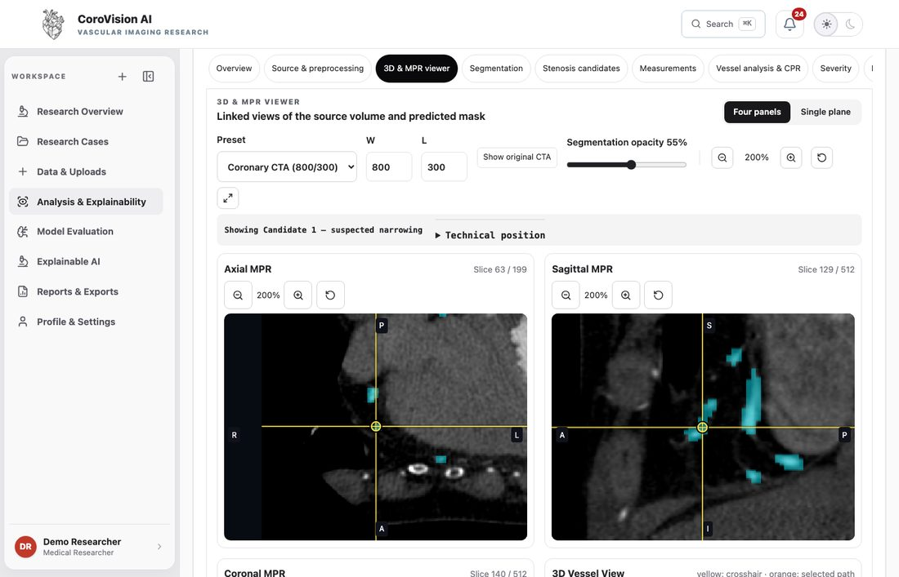
*Linked axial, sagittal and coronal views with the segmentation.*

| Button | What it does | When to use it | How to use it |
|---|---|---|---|
| Four panels / Single plane | Shows all four views or one large view. | Single plane for detail. | Click one. |
| Preset (Coronary CTA 800/300, Soft tissue, Lung, Bone) | Sets window width and level for the CT contrast. | To make the right tissue visible. Use Coronary CTA for vessels. | Choose a preset, or type W and L yourself. |
| W and L | Window width and level numbers. | For fine tuning. | Type values. |
| Show original CTA / Show segmentation | Hides or shows the mask. | To check the mask against the raw scan. | Click it. |
| Segmentation opacity | How strong the mask colour is. | To see anatomy under it. | Drag the slider. |
| Zoom out / Zoom in all MPR panels, Reset zoom and crosshair | Zoom all slice views together or reset. | For overall inspection. | Click. |
| Zoom out, Zoom in, Fit for Axial, Sagittal or Coronal | Zoom one plane only. | To inspect one view. | Click the icon on that panel. |
| Full screen | Makes the viewer fill the screen. | For presentation. | Click it, press Esc to leave. |
| Crosshair (yellow) | Marks the same point in every view. | To locate a spot. | Click in any view to move it. Slice numbers update. |
| Technical position | Shows the exact position in millimetres. | To record where you are. | Open the box. |
| 3D surface: Angled, Anterior, Lateral, Superior | Preset camera angles for the vessel model. | To look from a side. | Click one. |
| 3D surface: Rotate left/right, Tilt up/down | Turns the 3D model. | To look around it. | Click, or drag the model. |
| Zoom out / in 3D, Fit vessel surface | Resizes the 3D model. | For detail. | Click. |
| 3D surface opacity, Floor grid | Style of the 3D view. | For clarity. | Slider and tick box. |
| Show N disconnected fragments | Includes small separate pieces of the mask. | To see everything the model drew. | Tick it. Large pieces are shown by default. |


#### F5.2 Segmentation: components and reviewer corrections

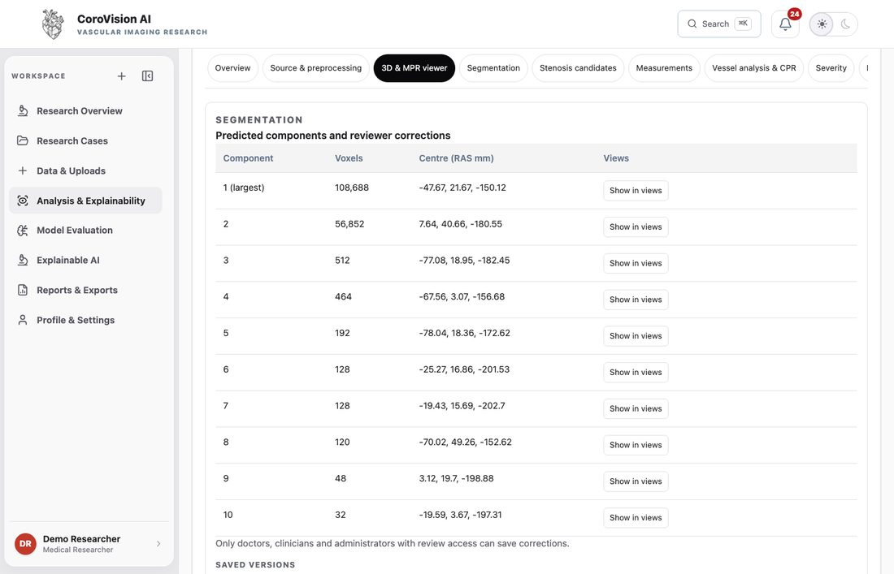
*Predicted components, with their size and centre.*

| Button | What it does | When to use it | How to use it |
|---|---|---|---|
| Show in views | Moves all views to that component. | To inspect one piece. | Click on a row. |
| Exclude | Marks a component as not coronary. | For a wrongly detected piece, for example outside the heart. | Tick it, add a reason, save. |
| Paint crosshair voxel / Erase crosshair voxel / Undo last voxel | Edits the mask one voxel at a time at the crosshair. | For small manual fixes by an authorised reviewer. | Move the crosshair, click the tool. |
| Reason for the correction | Explains the edit. | Always when you save a correction. | Type a short reason. |
| Saved versions, NIfTI, Original model mask | Each saved edit is a new version. You can download it or return to the original model mask. | To keep the history. | Click a version. |

> **Tip.** Edits never overwrite the original model mask. Only doctors, clinicians and administrators with review access can save corrections.


#### F5.3 Vessel analysis and curved reformation (CPR)

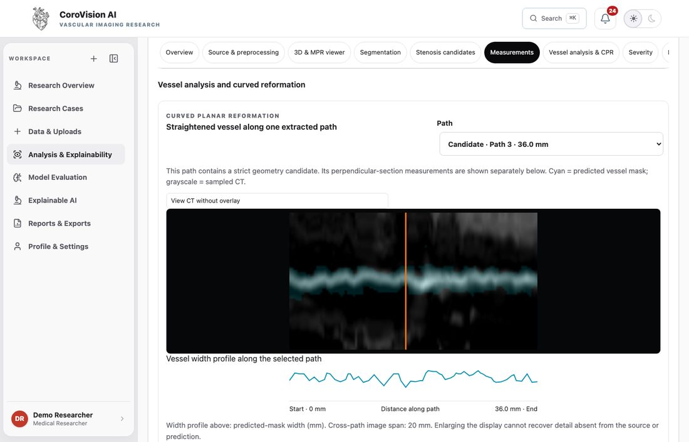
*A straightened vessel along one extracted path, with its width profile.*

| Button | What it does | When to use it | How to use it |
|---|---|---|---|
| Path (selector) | Chooses which extracted vessel path to straighten. | To study a branch. | Pick a path. |
| View CT without overlay | Hides the mask on the straightened image. | To judge the raw vessel. | Click it. |
| CPR mask overlay opacity | Strength of the mask on the CPR image. | For clarity. | Drag. |
| Rotation about the vessel axis | Turns the view around the vessel. | To check all sides. | Drag the slider. |
| Advanced CPR display controls, Display proportions, Preserve physical proportions, Expand path to panel width | How the image is stretched. | Keep proportions on for true shapes. | Open the box and choose. |
| Distance along path | Position in millimetres along the vessel. | To find where a feature is. | Click on the image or profile. |
| Vessel width profile | Width in millimetres along the path. | To see tapering and narrowing. | Read the chart. A dip may suggest narrowing. |
| Minimum position and Reference position (mm) | Reviewer's own choice of the narrowest point and a healthy reference point. | To record your judgement. | Type values or click on the profile. |
| Decision (Accept as vessel, Uncertain, Reject), Narrowing, Artery, Notes | Saves your review of the path. | To record a decision on a path. | Choose, add notes, save. It is stored as a separate version with your name and time. |
| Clear markers | Removes your markers. | To start over. | Click it. |


#### F5.4 Candidates, measurements and severity

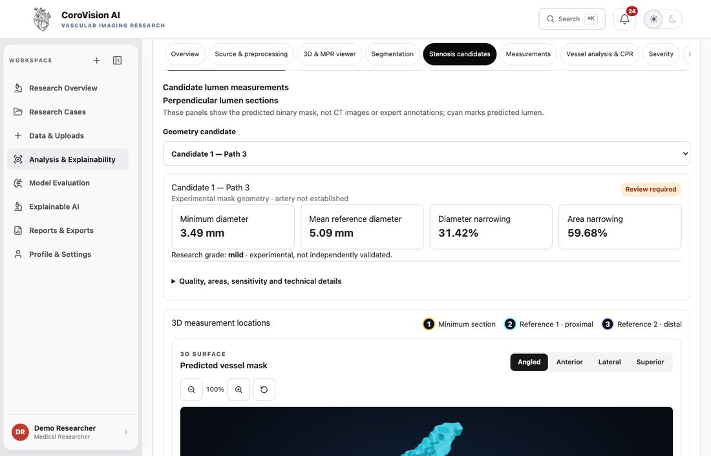
*Perpendicular lumen sections and measurements for one candidate.*

| Button | What it does | When to use it | How to use it |
|---|---|---|---|
| Select a geometry candidate | Chooses which suspected narrowing to inspect (Candidate 1 - Path 3 and so on). | To move between candidates. | Pick one. |
| View in MPR + 3D | Moves the crosshair and 3D view to that candidate. | To see it in context. | Click it. |
| Minimum diameter, Reference diameter, Diameter narrowing, Area narrowing | Numbers measured on the predicted mask. | To judge size. | Read them. They are experimental, from the mask only. |
| Quality, areas, sensitivity and technical details | Quality checks and how sensitive the result is to sampling. | To decide whether to trust the numbers. | Open the box. |
| View 2D cross-sections and exact section values | Shows perpendicular slices and their exact values. | For close study. | Open the box. |
| Measurement locations (1 Minimum, 2 Reference proximal, 3 Reference distal) | Markers in 3D. | To see where measurements were taken. | Look at the numbered markers. |

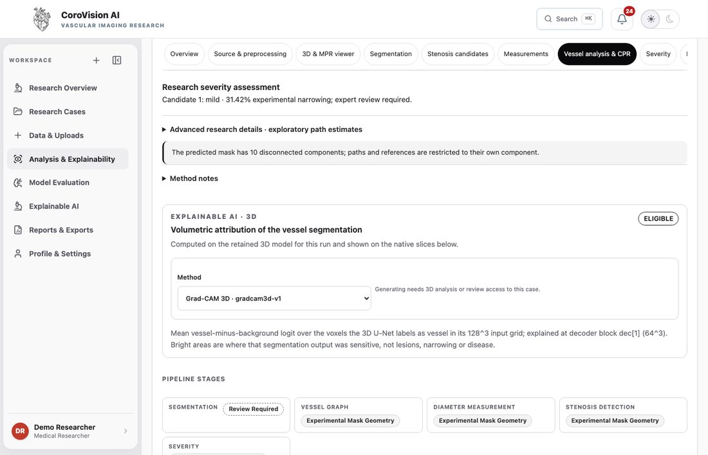
*Research severity text for the 3D result.*

> **Important.** 3D severity is experimental, based on the predicted mask only, and always says expert review is required. It is not a clinical grade.


#### F5.5 Model evaluation, review and reports for 3D

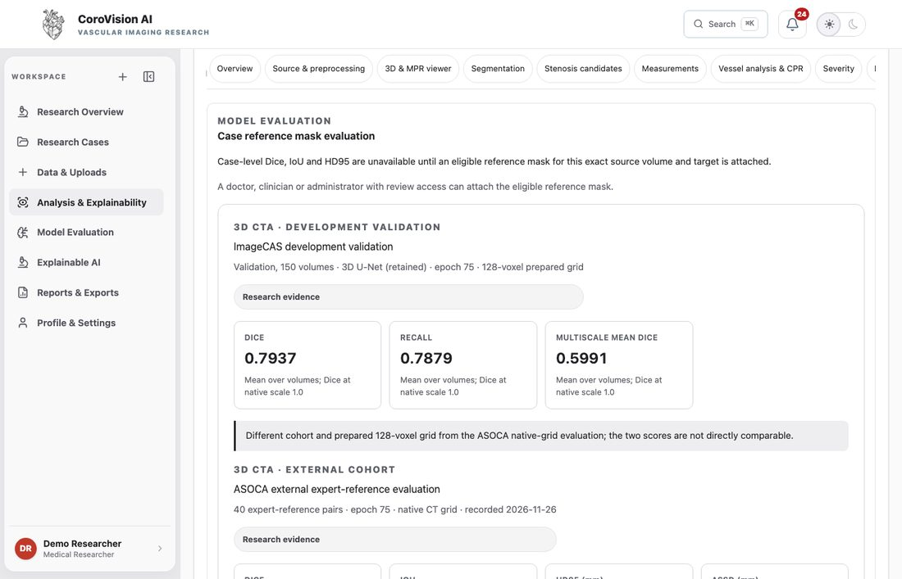
*Reference mask evaluation and published validation.*

**Case reference mask evaluation** compares the prediction with an expert mask for the same source volume. It shows Dice, IoU, HD95 and ASSD only when a matching reference is attached. Without it the page says the numbers are unavailable. **ImageCAS development validation** and **ASOCA external expert-reference evaluation** show how the model did on those cohorts (they are different data and not comparable).

| Button | What it does | When to use it | How to use it |
|---|---|---|---|
| Source-grid mask (NIfTI) | Downloads the mask in the original scan geometry. | To use the mask in another tool. | Click it. |
| Probability volume | Downloads the model's probability values. | For research. | Click it. |
| Result JSON | Downloads the full machine-readable result. | For scripts. | Click it. |

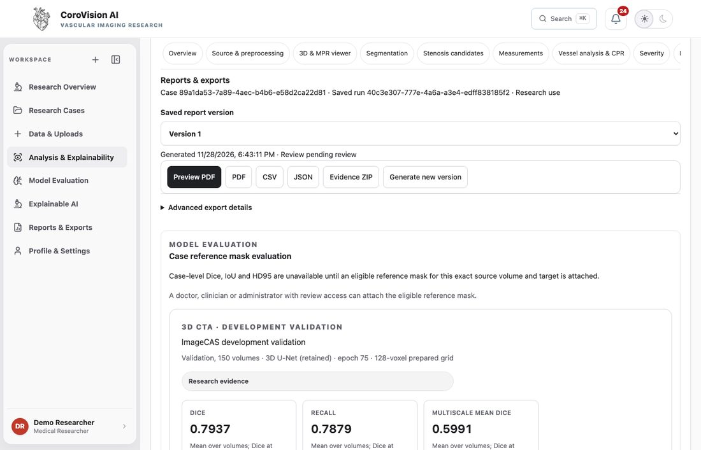
*Reports and exports for a saved 3D run.*


### F6. Severity Review

A queue of cases waiting for or holding a human review. It is where a doctor records their own decision. The AI output is shown for reference, but the decision is stored separately and never mixed with it.

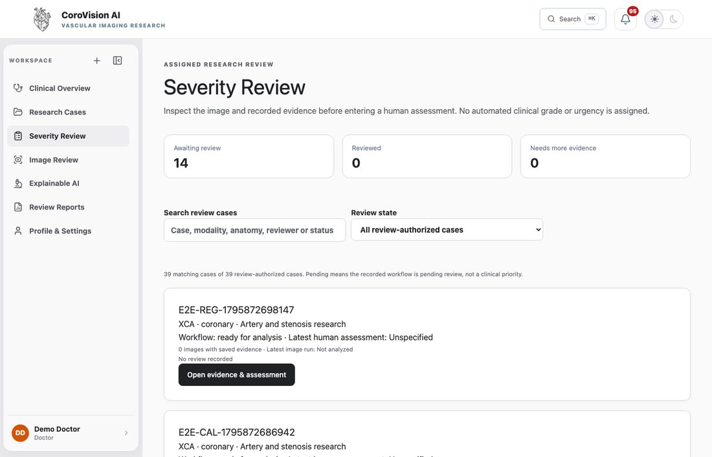
*The review queue.*

| Button | What it does | When to use it | How to use it |
|---|---|---|---|
| Search (case, modality, anatomy, reviewer or status) | Filters the queue. | To find a case. | Type, and use the filter menu. |
| Open evidence & assessment | Opens that case's saved analysis with the decision form. | To start or read a review. | Click it on a row. |
| Back to review queue | Returns to the list. | After reviewing. | Click. |
| 1 Image Review, 2 Explainable AI, 3 Severity Review, 4 Reports | A four-step path through the review. | To work in order. | Click each step; steps unlock once a run exists. |

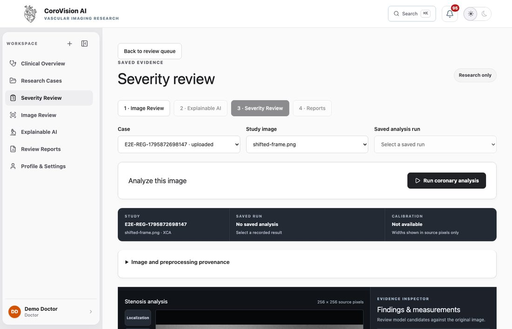
*An opened review.*

Further down, the **Doctor's decision** form records the decision, the assessed severity, notes and follow-up. Submitting it saves your assessment with your name and the time. It does not change the AI result.


### F7. Explainable AI

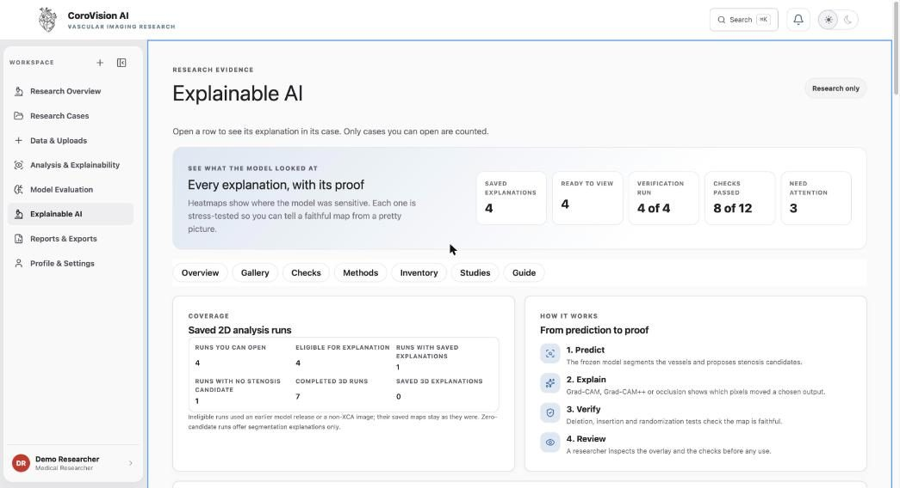
*The Explainable AI page.*

Explainability shows **where in the image the model was looking** when it made a finding, and then tests whether that map is trustworthy. Heat maps are not proof that a finding is true.

| Button | What it does | When to use it | How to use it |
|---|---|---|---|
| Overview, Gallery, Checks, Methods, Inventory, Studies, Guide | Jump to parts of the page. | To go straight to what you need. | Click a tab. |
| Top numbers (Saved explanations, Ready to view, Verification run, Checks passed, Need attention) | Summary of all saved explanations. | To judge overall coverage. | Read them. |
| Gallery: Overlay on the image / Heatmap only / Raw attribution map | Changes how each saved explanation image is drawn. | To see it in different ways. | Click one. |
| Gallery cards | A saved explanation with its case, method and result. | To open the exact case and run. | Click a card. |
| Method filter (All, Grad-CAM, Grad-CAM++), check filter, case-code filter | Narrows the list. | To find a record. | Choose or type. |
| Download list (CSV) | Saves the table of explanations. | For records. | Click it. |
| Checks (deletion, insertion, randomization) | Show whether removing or adding the highlighted area changes the output as expected, and whether a random model gives a similar map. | To judge faithfulness. | Read pass, fail or not tested. |

> **Tip.** Making an explanation: open a 2D analysis, choose a layer such as Grad-CAM in the viewer, or open the Explainable AI section of the run. In 3D, use the Explainable AI section of the CTA page.


### F8. Model Evaluation (Model Registry)

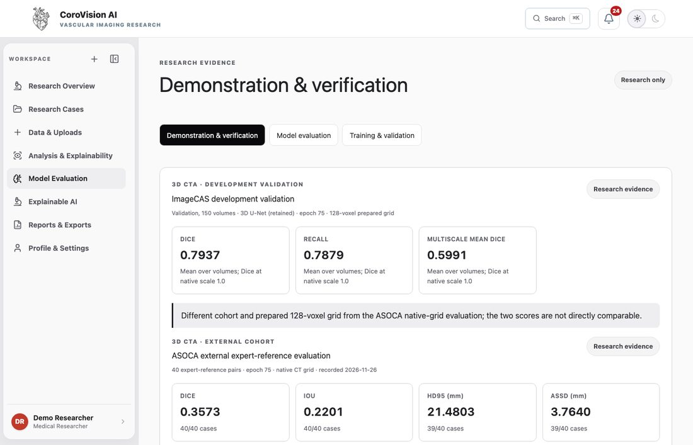
*Recorded model results.*

Shows which models are installed, how they were trained and the measured results. Nothing here starts training. Administrators see it as Model Registry; researchers and ML engineers as Model Evaluation.

| Button | What it does | When to use it | How to use it |
|---|---|---|---|
| Demonstration & verification | Evidence that the application behaves as documented, using clearly labelled known-truth fixtures. | To see what was verified. | Click the tab. |
| Model evaluation | Registry, architecture, model comparison and monitoring. | To see the models. | Click the tab. Administrators also see live monitoring. |
| Training & validation | Training scope, datasets and limits. | To understand how far the evidence goes. | Click the tab. |
| Research evidence | Opens the source of a number. | To trace a result. | Click the button on a card. |

> **Important.** ImageCAS validation and ASOCA external results are different cohorts and grids. Do not compare the two scores. The 2D models were trained on ARCADE only. Independent clinical validation has not been done.


### F9. Reports & Exports

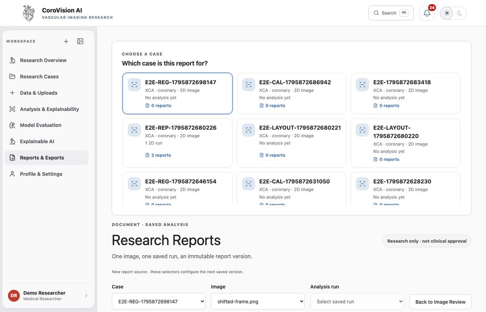
*The Reports hub with the case chooser.*

Choose a case, then a run, and save an **immutable report version**. A report repeats a saved run exactly and never re-runs the model.

| Button | What it does | When to use it | How to use it |
|---|---|---|---|
| Case cards (Which case is this report for?) | Each card shows the study type, number of runs and reports. | To pick the case. | Click a card. |
| Saved analysis run (3D) / Study image and Saved run (2D) | Chooses what to report on. | To pick the run. | Select it. |
| Open the full analysis / Back to Image Review | Goes to the analysis page. | To check the result first. | Click it. |
| Preview PDF | Shows the PDF in the page. | To check it before downloading. | Click it. |
| PDF, CSV, JSON, Evidence ZIP | Download the report in that format. The ZIP also holds the images and file hashes. | PDF to read, CSV for spreadsheets, JSON for software, ZIP as full evidence. | Click the format. |
| Generate new version / Save new report version | Creates the next numbered version. | When you want a fresh export. | Click it. Old versions stay. |
| Saved report version (selector) | Chooses which version to download. | To get an older version. | Pick the version. |
| Contents (checkboxes) | Chooses what goes into a 2D report: images, measurements, candidates, review. | To shorten or lengthen the report. | Tick or untick. |

> **Important.** Exports need export permission on the case and in your role. If you see Research export permission required, ask the case owner or an administrator.


### F10. Profile & Settings

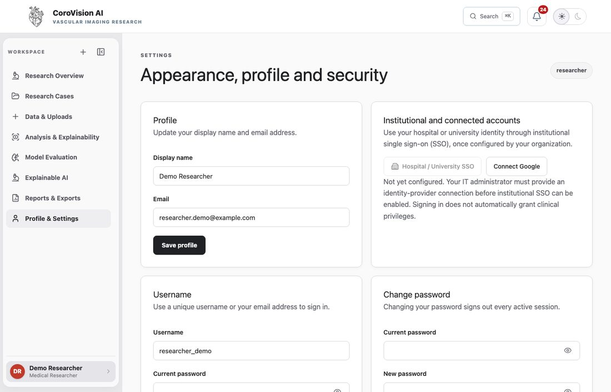
*Profile and security.*

| Button | What it does | When to use it | How to use it |
|---|---|---|---|
| Save profile | Stores your name and email. | After editing. | Click it. |
| Username / Save username | Sets your sign-in name. | To choose a short name. | Type and save. |
| Change password | Sets a new password. | Regularly, or if you suspect a leak. | Type the current and new password, click it. |
| Show password (eye) | Reveals what you typed. | To check typing. | Click. |
| Connect Google / Hospital or University SSO | Links another sign-in method. | When your site has set it up. | Click and follow the steps. |
| Sessions: Show all sessions, Sign out all sessions | Lists where you are signed in and ends them all. | If you lost a device. | Click, then sign in again. |
| Recent activity: Show all activity | A history of your own actions. | To audit your use. | Click. |
| Request workspace access (role, reason) / Submit access request | Asks an administrator for a different role. | When you need more access. | Pick the role, describe the need without patient details, submit. |
| Appearance | Chooses how the interface looks. | For comfort. | Pick an option and it applies at once. |


## Part G. Complete 2D walkthrough (X-ray angiography)

1. Sign in and open **Research Cases** (or use the + button).
2. Click **Create case**. Enter a code such as DEMO-2D-001, Modality **X-ray angiography**, Anatomy **coronary**, Intended task **Artery and stenosis research**. Click **Create research case**.
3. Open **Data & Uploads**. Choose **Case image preparation**. Drop in a de-identified angiogram (PNG, JPEG, DICOM or scanned PDF). Keep the profile on **Standard**. Click **Validate and upload**.
4. Wait for the three steps (Select, Validate, Quality check) to turn green. Look at the preview to make sure it is the right image.
5. Click **Open analysis**. Check that Case, Study image and Saved run show your study.
6. Click **Run coronary analysis**. Wait until the run appears. This usually takes under a minute.
7. Read **Combined findings** on the Overview. Note whether the screening result says model-flagged region and how many candidates were saved.
8. Open the **2D viewer**. Click **Original**, then **AI overlay**. Zoom in. Use Compare with to check the overlay against the original.
9. Open **Stenosis candidates**. Click C1, C2 and C3 in turn to see each one on the image. Remember they are suspected regions only.
10. Open **Vessel analysis** and **Measurements & severity**. If no calibration is recorded, widths are in pixels and severity says not assessed. That is correct.
11. Open **Explainable AI**. View Grad-CAM or Grad-CAM++ and read the check results.
12. A doctor opens **Severity Review**, clicks **Open evidence & assessment** and records a decision and notes.
13. Open **Reports & exports**. Click **Save new report version**, then download **PDF**, **CSV**, **JSON** and **Evidence ZIP**.
14. Reload the page. Open **Analysis history** on the case and reopen the saved run. It is the same result.
15. Sign out from the account menu. Open the address again: you are sent back to sign-in.


## Part H. Complete 3D walkthrough (coronary CTA)

1. Make sure the 3D model file is installed (Part C2) and the health check shows the 3D model as available.
2. Create a case with Modality **CTA** and Anatomy **coronary** (or aorta).
3. Open **Data & Uploads**. Choose **Research volume workflow**. Choose the NIfTI file, a ZIP of DICOM or the DICOM files. Tick the Hounsfield-unit and research-only boxes. Click **Run 3D segmentation**.
4. Wait while the status goes from queued to running to completed. Click **Open saved 3D analysis**.
5. On **Overview**, read the model name, volume size, number of paths and candidates.
6. On **Source & preprocessing**, check that every line says Checked.
7. In the **3D & MPR viewer**, keep the preset on Coronary CTA. Move the crosshair. Use **Show original CTA** to compare the mask with the raw scan. Try **Single plane**, **Full screen** and the 3D buttons Angled, Anterior, Lateral and Superior.
8. In **Segmentation**, click **Show in views** on a small component. If it is clearly not a coronary vessel, a reviewer can exclude it and give a reason.
9. In **Stenosis candidates**, choose a candidate and click **View in MPR + 3D**.
10. In **Measurements**, read minimum and reference diameter and the narrowing. Open the quality details to see whether the numbers can be trusted.
11. In **Vessel analysis & CPR**, choose a path and read the straightened vessel and the width profile. A reviewer may set minimum and reference positions and choose Accept, Uncertain or Reject. This is saved as a new version.
12. Read **Severity**. It is research-only and says expert review is required.
13. Open **Explainable AI** to create or view the volumetric attribution.
14. Open **Model evaluation**. If a matching expert reference mask exists, attach it to see Dice, IoU and HD95.
15. Click **Create report**. On Reports, **Generate new version**, then **Preview PDF** and download PDF, CSV, JSON and Evidence ZIP.
16. Reopen the case later from Analysis history. The saved run, reviewer edits and reports are all still there.


## Part I. Administration

These sections are for administrators only. Every action here is recorded in the Audit Log.


### I1. User Management

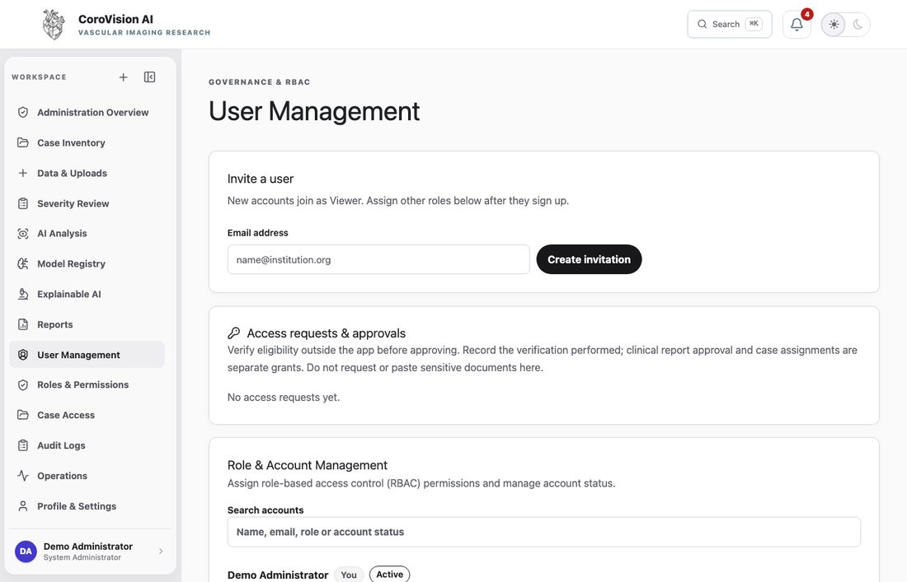
*User Management.*

| Button | What it does | When to use it | How to use it |
|---|---|---|---|
| Invite a user (email and role) and Create invitation | Creates a single-use invitation valid for 24 hours, tied to one email. | To add a person to your installation. | Type the email, choose a role, click Create invitation, send them the link. |
| Search (name, email, role or status) | Filters accounts. | To find a person. | Type. |
| Role & account management (per user) | Change role, suspend or reactivate an account. | When someone changes job or leaves. | Open the user, choose the new state, confirm. |
| Access requests & approvals | Requests users sent from Profile & Settings. | To grant or decline extra access after checking eligibility. | Open a request and record your decision. |


### I2. Roles & Permissions

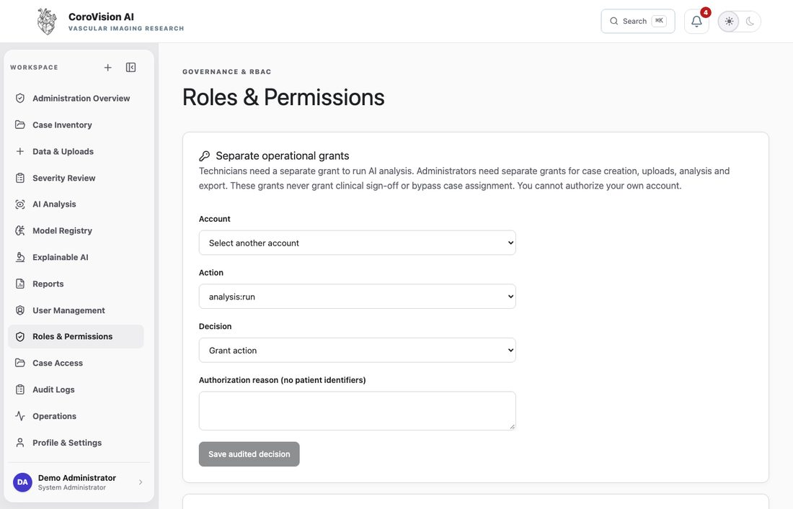
*Roles and permissions.*

| Button | What it does | When to use it | How to use it |
|---|---|---|---|
| Operational permission matrix | Shows which role has which operational grant. | To understand current rights. | Read it. |
| User, grant and reason fields, Save audited decision | Gives or removes a separate operational grant (for example clinical approval) with a written reason. | For exceptions beyond the role. | Pick the user and grant, write the reason, click Save audited decision. |


### I3. Case Access

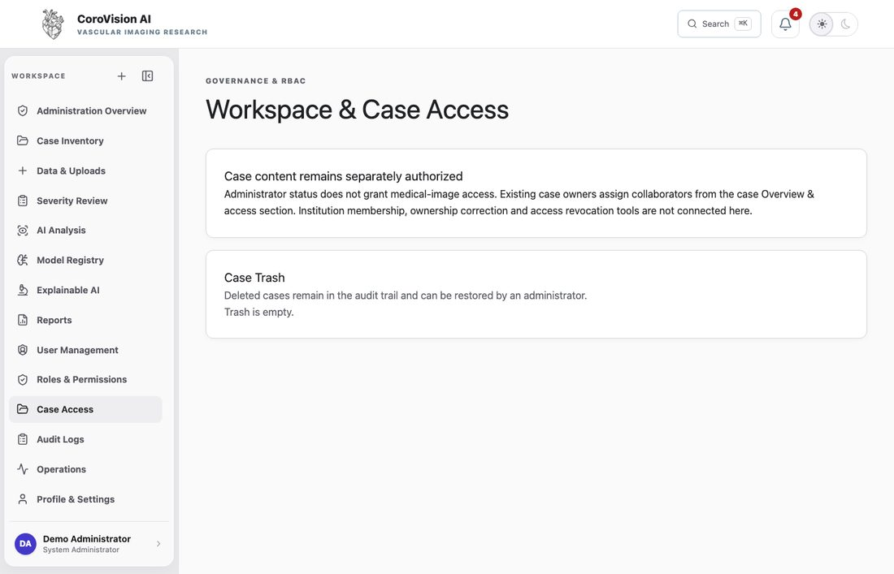
*Case Access and Case Trash.*

| Button | What it does | When to use it | How to use it |
|---|---|---|---|
| Workspace & Case Access | Who can open which cases. | To check or fix sharing. | Read the list. |
| Case Trash | Cases that were deleted. They can be restored. | To recover a case by mistake. | Choose the case and restore it. |


### I4. Audit Logs

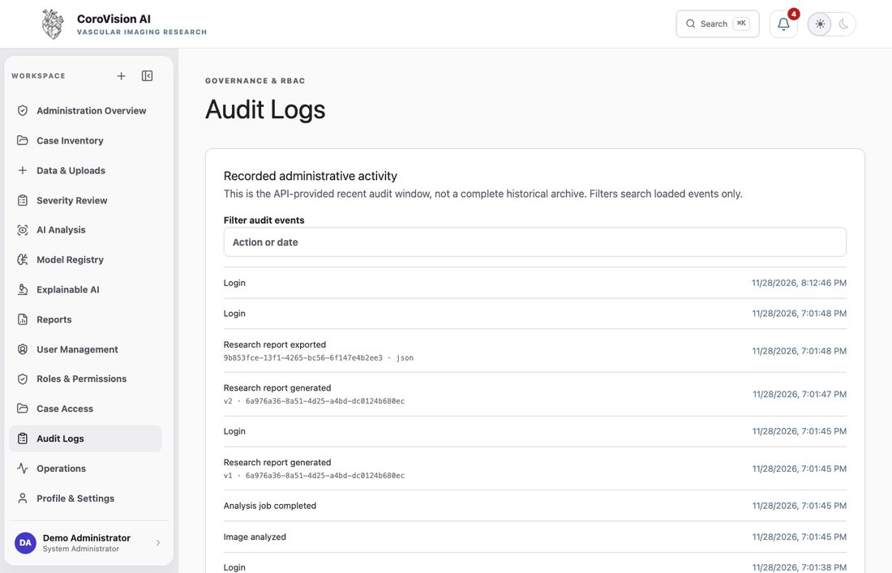
*The audit log.*

| Button | What it does | When to use it | How to use it |
|---|---|---|---|
| Action or date (filter) | Filters recorded events. | To find who did what. | Type an action name or a date. |
| Show all loaded events | Expands the list beyond the first rows. | To see everything loaded. | Click it. |


### I5. Operations (monitoring and alerts)

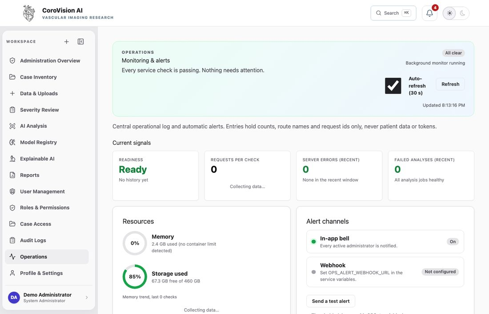
*The Operations console.*

| Button | What it does | When to use it | How to use it |
|---|---|---|---|
| Status banner (All clear or alert level) | Summarises health. | First glance. | Read it. |
| Auto-refresh (30 s) and Refresh | Updates the page automatically or on demand. | To watch live. | Tick the box or click Refresh. |
| Readiness, Requests per check, Server errors, Failed analyses | Four key numbers with trend lines. | To spot problems. | Red numbers need attention. |
| Resources: memory and storage gauges | Percent of memory and disk used. | To avoid running out. | Turn red at the warning level. |
| Alert channels, Send a test alert | Shows the in-app bell and webhook, and sends a test message. | After setting up a webhook. | Click Send a test alert, check the bell. |
| Thresholds | The alert limits, changed with OPS_ variables. | To tune alerts. | Open the list. |
| Live API traffic: Busiest, Slowest, Most errors | Per-route request counts and speed since the service started. | To find slow or failing parts. | Click a sort button. |
| Trends: 1 h, 6 h, 24 h | Charts of requests, errors and free storage. | To see change over time. | Choose a range. |
| Event log: level chips, search, Download events (CSV) | Filters the log, searches by message or request id, and exports. | To investigate an incident. | Pick a level, type in the search box, click Download. |


## Part J. Help


### J1. Glossary

| Term | Meaning |
|---|---|
| XCA | X-ray coronary angiography: a 2D moving or still X-ray image of the heart's arteries. |
| CTA | CT angiography: a 3D scan of the arteries. |
| Segmentation / mask | The model's outline of the artery, drawn over the image. |
| Centerline | A thin line running through the middle of each vessel. |
| Stenosis / narrowing | A section of artery that is narrower than it should be. |
| Candidate | A region the model flags as a possible narrowing. Not a confirmed finding. |
| MLD / RVD | Minimum lumen diameter and reference vessel diameter, used to estimate percentage narrowing. |
| MPR | Multiplanar reconstruction: axial, sagittal and coronal slices of a 3D scan. |
| CPR | Curved planar reformation: a vessel straightened into one flat image. |
| Grad-CAM / Grad-CAM++ | Heat maps showing which parts of an image influenced the model. |
| Dice, IoU, HD95, ASSD | Scores for how closely a mask matches an expert mask. Higher Dice and IoU are better; lower HD95 and ASSD are better. |
| Hounsfield unit (HU) | The brightness scale of a CT scan. |
| De-identified | Has had all personal identifying details removed. |
| Immutable report version | A saved report that is never changed. A new export makes a new version. |


### J2. Troubleshooting

| Problem | What to check |
|---|---|
| The page does not open | Run docker compose ps and curl http://127.0.0.1:8000/api/health/ready. Check the port is free. |
| Port 8000 in use | Change COROVISION_PORT in .env, then docker compose up -d. |
| Cannot sign in after a restart | Do not change JWT_SECRET. If you did, sign in again. |
| A section is missing | Your role does not include it. Ask an administrator. |
| 3D analysis unavailable | The 3D model file is missing. Follow Part C2. |
| Run coronary analysis does nothing | Check that the 2D models are installed: the health check should show 2d available. |
| PDF scan rejected | Install Poppler (brew install poppler, or apt install poppler-utils) and check pdftoppm -v. |
| DICOM rejected | Compressed DICOM may need extra decoders. The app shows a clear message rather than guessing. |
| Export is refused | You need export permission on the case and in your role. |
| Google sign-in fails | Check the client ID, secret, origin and redirect URI in Part C4. |
| Old version still shows after an update | Rebuild (docker compose up --build -d) and press Cmd+Shift+R in the browser. |
| Lost the administrator password | See docs/ADMIN_ACCESS.md for the recovery steps. |


### J3. Responsible use

- Use only public or de-identified images. Never type personal details.
- AI output and a doctor's assessment are different records. A mask is not a confirmed lesion; a score is not clinical confidence.
- Widths and areas in pixels are not physical measurements unless calibration is recorded.
- No candidate does not mean normal. The app never reports a normal finding for that reason alone.
- Models were evaluated on research data only. They are not independently validated for clinical use.
- Real patient use or public deployment needs an approved privacy and security process.


### J4. More documentation

| Topic | File |
|---|---|
| Quick start for a clean clone | docs/QUICKSTART.md and docs/FRESH_CLONE_SETUP.md |
| Administrator setup and recovery | docs/ADMIN_ACCESS.md |
| Sign-in, Google and email | docs/AUTH_SETUP.md |
| 2D AI analysis | docs/AI_ANALYSIS.md |
| 3D inference and CTA workspace | docs/3D_INFERENCE.md and docs/3D_CASE_WORKSPACE.md |
| Explainable AI | docs/EXPLAINABLE_AI.md |
| Monitoring and operations | docs/MONITORING_AND_LOGGING.md and docs/OPERATIONS_AND_READINESS.md |
| Shared team workspace | docs/SHARED_CASE_WORKSPACE.md |
| Architecture | docs/ARCHITECTURE.md |

